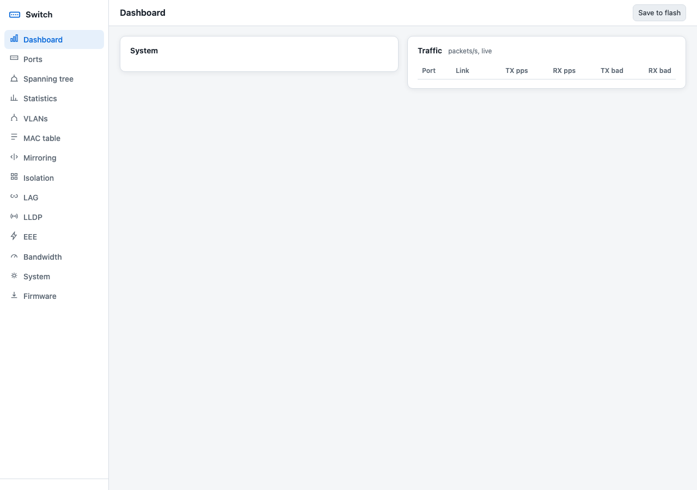
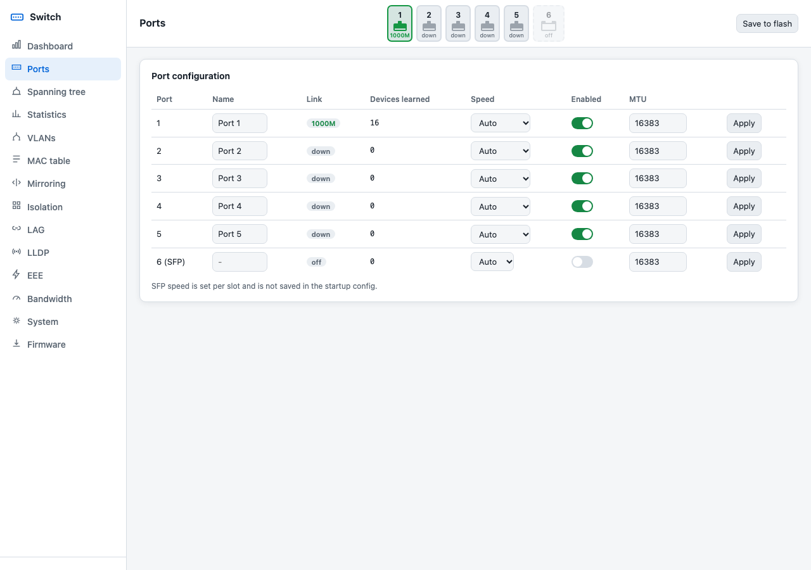
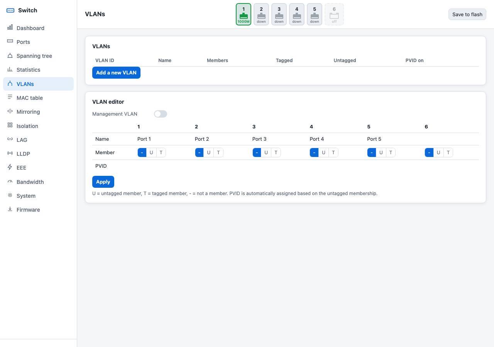
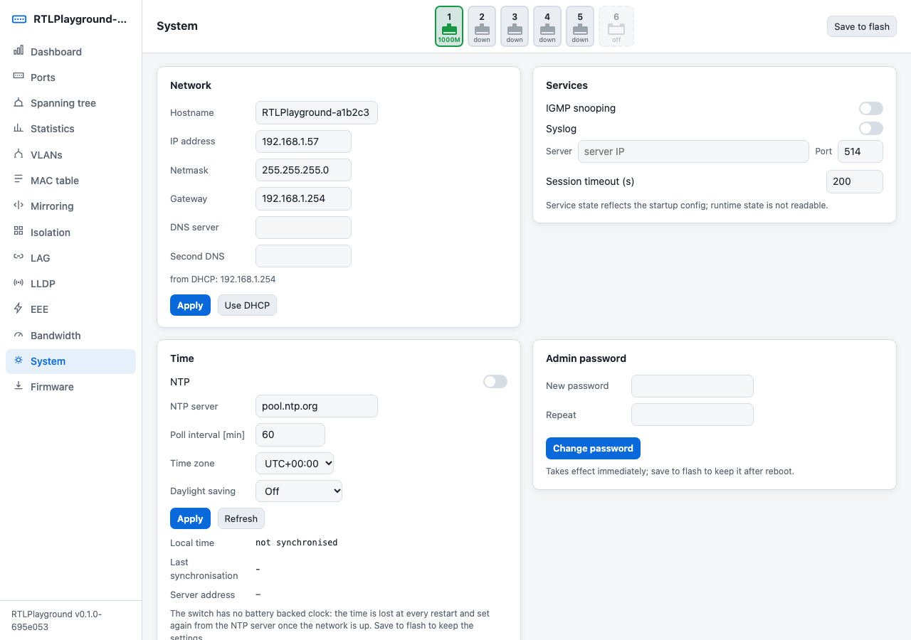
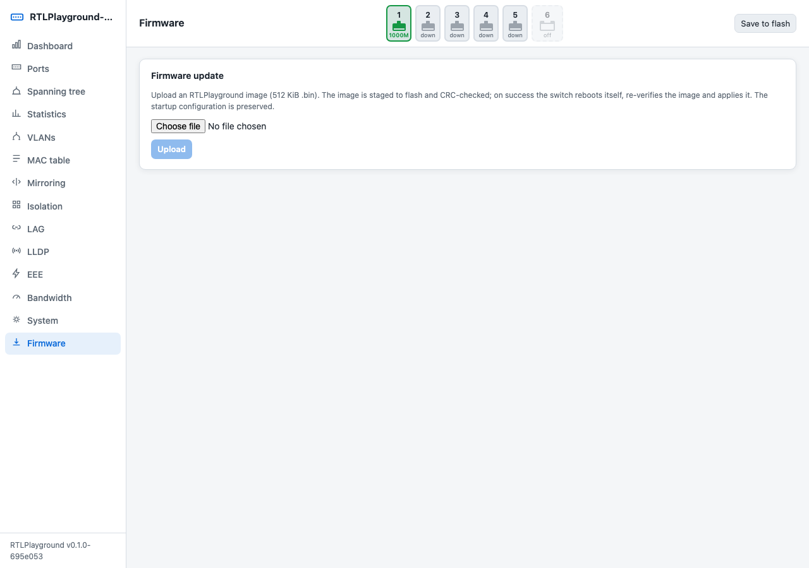

# HoraFlex

Horaco HC-SWTGW215AS as a UniFi Switch Flex Mini 2.5G.

Firmware that lets a UniFi Network controller adopt and manage a Horaco HC-SWTGW215AS
(5 x 2.5GbE RJ45 + 1 x 10G SFP+) as a **USW-Flex-2.5G-5** (Switch Flex Mini 2.5G).

The HC-SWTGW215AS uses the same class of Realtek RTL8372 switch chip as small 2.5G switches
in general and costs a fraction of the UniFi model. This project replaces its stock firmware with
[RTLPlayground](https://github.com/logicog/RTLPlayground), an open-source firmware for RTL837x
switches, and adds a UniFi device agent that runs on the switch's own 8051 CPU. The agent
implements the device side of the UniFi inform protocol: discovery by the controller, adoption,
AES-GCM encrypted informs, and applying the port and VLAN configuration the controller sends.
No extra hardware, Raspberry Pi or helper service is needed.

> Not affiliated with or endorsed by Ubiquiti or Horaco. UniFi is a trademark of Ubiquiti Inc.
> The UniFi device protocol is undocumented; this implementation follows observed controller
> behaviour. Replacing switch firmware can make the device unusable; without a SOIC-8 clip and SPI
> programmer a switch that does not boot cannot be recovered.

## The hardware


<sub>Horaco HC-SWTGW215AS (image: HORACO)</sub>

**Model: Horaco HC-SWTGW215AS**, "2.5G Web Managed Switch": 5 x 2.5GbE RJ45 + 1 x 10G SFP+,
metal case, port 6 labelled "SFP+(10G)". The one used here was bought from
[this AliExpress listing](https://www.aliexpress.com/item/1005010660780744.html).

Horaco and other brands sell many switches that look almost the same (4+1, 8+1, unmanaged, PoE,
different chips). Only the **HC-SWTGW215AS** has been tested. The web-managed version is needed:
an unmanaged switch has no web page to upload the firmware through. If the listing offers several
variants, pick the 5 x 2.5G + 1 x 10G SFP+ **managed** one and check that the model name on the
label is HC-SWTGW215AS. The stock firmware tested was V200.1.10.

### What UniFi sees it as

UniFi shows the switch as a **USW-Flex-2.5G-5** (Switch Flex Mini 2.5G, model code USWED35).
How the two compare:

| | Horaco HC-SWTGW215AS with HoraFlex | UniFi USW-Flex-2.5G-5 |
|---|---|---|
| RJ45 ports | 5 x 2.5GbE | 5 x 2.5GbE |
| SFP+ | 1 x 10G (works as a normal switch port, not shown in UniFi) | none |
| Power | its own power adapter | USB-C (5 V 1 A) or PoE from port 1 |
| Managed by UniFi | yes, ports and VLANs (see [What works](#what-works)) | yes, all features |
| Firmware updates | from this project's releases, not from UniFi | from UniFi |
| Switching capacity | 45 Gbps (Horaco) | 25 Gbps |
| Size | larger (metal desktop case) | 117 x 90 x 21 mm |

Ubiquiti's full specifications:
[techspecs.ui.com/unifi/switching/usw-flex-2-5g-5](https://techspecs.ui.com/unifi/switching/usw-flex-2-5g-5).
The USW-Flex-2.5G-5 needs UniFi Network 8.6.9 or newer.

### Screenshots

The switch's own web page after installing:



<details>
<summary>More pages: ports, VLANs, system, firmware update</summary>






</details>

## What works

Tested on one HC-SWTGW215AS (stock firmware V200.1.10) with a UniFi Cloud Gateway Ultra running
UniFi Network 10.6.109:

| Feature | Status |
|---|---|
| Shows as Pending Adoption, adopts, stays online (AES-GCM) | tested |
| Port enable / disable | tested (link goes down and up) |
| Native VLAN, blocked tagged VLANs, port profile changes | tested |
| Tagged VLANs | tested in the switch's VLAN table; not checked with a packet capture |
| Port names | tested |
| Reboot and firmware update without re-adoption | tested |
| Out of the box: DHCP, finds the UniFi gateway, adopt | tested |
| Reset button: restart (hold 3-10 s) and factory reset (hold > 10 s) | tested |
| Forget / remove in UniFi (ports return to a plain switch) | tested |
| Link state, speed and packet counters per port | tested |
| 2.5G links, SFP+ port | not tested (the SFP+ is not shown in UniFi and keeps forwarding on VLAN 1) |
| Byte counters, client lists, LLDP topology, PoE | not provided |
| Management VLAN other than 1 | not supported |

Other controllers (UniFi OS consoles, self-hosted Network application) and other Network versions
may work but are untested. Other RTL8372/8373 switches supported by RTLPlayground may work with a
different `MACHINE`, but only this model has been tried.

## Port mapping

UniFi ports 1-5 are the front-panel RJ45 ports 1-5 (left to right). The SFP+ cage is not reported
to UniFi.

## Installation

You need a computer with a wired Ethernet port and the files from the
[latest release](../../releases/latest):

- `...-oem-upgrade.bin` for a switch still on its stock firmware
- `...-SWTG024AS_A_2_0_1_5C_1SFP.bin` for a switch already running this firmware or RTLPlayground
- `SHA256SUMS` to check the downloads

### 1. Install the firmware (switch with stock firmware)

1. Connect the computer directly to any RJ45 port of the switch and give the computer a fixed
   address in the switch's network, for example `192.168.2.2`, netmask `255.255.255.0`:
   - Windows: Settings > Network > Ethernet > IP assignment > Edit > Manual > IPv4.
   - macOS: System Settings > Network > (the Ethernet adapter) > Details > TCP/IP > Configure IPv4: Manually.
2. Open `http://192.168.2.1` and log in to the stock web interface (default `admin` / `admin`).
   Note the firmware version under System; this was tested with V200.1.10.
3. Open System > Firmware Upgrade, confirm, and upload the **`-oem-upgrade.bin`** file. Do not upload
   the other `.bin` to the stock firmware.
4. Wait at least 5 minutes and do not power off the switch. It reboots into the new firmware.
5. Set the computer back to automatic network settings.

### 2. Connect it and adopt it

1. Connect any port of the switch to your UniFi network.
2. The switch gets an address from your router (DHCP) and contacts the network's gateway by itself.
   With a UniFi gateway (UCG, UDM, UXG, ...) that is the controller, so within a minute the switch
   appears in **UniFi Network > Devices** as **USW Flex 2.5G 5**, waiting for adoption.
3. Click **Adopt**. Manage ports and VLANs from UniFi as usual.

The port the switch reaches UniFi through is protected: the switch refuses any change from UniFi
that would disable that port or remove the Default network from it.

If your UniFi Network application runs somewhere else (a Cloud Key, or a computer), tell the switch
where it is; see the next section.

### 3. Recommended: change the web password

The switch's own web interface (`http://<switch address>`, the address is listed in UniFi) uses the
password `1234`. Change it in **System > Startup configuration** by adding a line, then save:

```
passwd MyNewPassword
```

## Settings

The switch works without any settings. These lines can be added in **System > Startup configuration**
(the switch's web interface) when needed; save and reboot (**System > Reboot switch**) afterwards.

| Line | Meaning |
|---|---|
| `unifi controller 192.168.1.10` | address of the UniFi Network application, when it is not the gateway (Cloud Key, computer) |
| `unifi off` | do not connect to UniFi; the switch works as a plain switch |
| `ip 192.168.1.240` | fixed address instead of DHCP. Use one outside the range your router hands out, and add `gw` and `netmask`, and remove the `ip dhcp` line |
| `gw 192.168.1.1` | gateway: your router's address (only with a fixed address) |
| `netmask 255.255.255.0` | your network's subnet mask; `255.255.255.0` for most home networks (only with a fixed address) |
| `unifi uplink 1` | always protect port 1 instead of the port the controller is reached through |
| `passwd ...` | password for the switch's web interface |

The startup configuration as shipped is:

```
ip 192.168.2.1
gw 192.168.2.254
netmask 255.255.255.0
ip dhcp
```

The first three lines are the address used when no DHCP server answers within a minute (the same
address as the stock firmware); `ip dhcp` takes an address from your router.

## Firmware updates from UniFi

The switch tells UniFi that it is a USWED35 at firmware 2.1.8.971, and that it only accepts firmware 99.0.0
or newer. UniFi therefore never offers it Ubiquiti's firmware ("Upgrade unavailable" in the controller
log), also with automatic updates turned on. Ubiquiti's firmware is for different hardware and would not
run on this switch.

If UniFi asks the switch to upgrade anyway, the switch installs nothing, keeps running this firmware and
reports the requested version, so UniFi considers the update done instead of retrying it. Both cases were
tested with a UCG Ultra.

Updates of this firmware (new releases here) are installed in the switch's own web interface, see
"Everyday tasks".

## Reset button

The reset hole is on the back, next to the power input. Use a paperclip:

| Hold | Result |
|---|---|
| 3-10 seconds, then release | restart |
| more than 10 seconds, then release | factory reset: the startup configuration as shipped, UniFi adoption cleared, then restart |

After a factory reset UniFi shows the switch as offline or "Adoption Failed", because UniFi still
expects the old adoption: remove the device in UniFi and adopt it again.

## Everyday tasks

| Task | How |
|---|---|
| Update the firmware | **Firmware** page of the switch's web interface: upload the new `...-SWTG024AS_A_2_0_1_5C_1SFP.bin`. Adoption and settings are kept. |
| Stop UniFi management | Add `unifi off` to the startup configuration and reboot. The ports keep their last settings. |
| Return to a plain switch | Remove the device in UniFi (this resets all ports to the Default network), then add `unifi off`. |
| See what the switch is doing | See "Reading the switch's log" below. |
| Back up the switch's memory | See [doc/unifi.md](doc/unifi.md#flash-backup-without-a-programmer). |

Going back to the stock Horaco firmware is only possible by opening the switch and writing a saved copy
of its original memory chip with a SPI programmer (a small USB device with a clip for the chip).

### Reading the switch's log

Status messages, including the output of the `unifi` command, are not shown on the web page. They go
to the switch's log, which it can send over the network ("syslog") to a computer:

1. Add to the startup configuration, with your computer's address, and save:

   ```
   syslog ip 192.168.1.50
   syslog on
   ```

2. On that computer, run a syslog receiver listening on UDP port 514, for example the free
   *Visual Syslog Server* on Windows, or on macOS/Linux:

   ```
   python3 -c "import socket;s=socket.socket(socket.AF_INET,socket.SOCK_DGRAM);s.bind(('',514));[print(s.recv(4096).decode(errors='replace'),flush=True) for _ in iter(int,1)]"
   ```

   (On Linux this needs `sudo`.)
3. In **System > Console** of the switch, type `unifi` and press Enter. The status appears in the
   receiver: whether the switch is adopted, how many messages succeeded or failed, and any error.

## Troubleshooting

| Problem | What to check |
|---|---|
| The switch never appears in UniFi | Check that the switch got an address: it is listed among the clients in UniFi, or in your router. Without DHCP it uses `192.168.2.1`. If the UniFi Network application is not on your gateway, add `unifi controller <its address>`. The controller listens on port 8080; a firewall between them must allow it. |
| UniFi shows "Adoption Failed" or the switch stays offline | Remove the device in UniFi and wait a minute; it appears again, ready to adopt. This is needed after a factory reset. Make sure the configuration does not contain `unifi discovery on`: with it, UniFi tries to adopt through a remote login (SSH) this switch does not have. |
| A change made in UniFi has no effect | Read the switch's log (above) and type `unifi`. A "Config error" other than 0 means the switch refused the change; error 8 or 9 means it would have disabled the uplink port or removed the Default network from it. |
| The switch's web page cannot be reached | Look up the switch's address in UniFi or your router. If nothing else helps, hold the reset button for more than 10 seconds (factory reset). |
| Unsure which firmware is running | The web interface's Dashboard shows the software version. |

## How it works

The agent (`unifi/`) informs the controller over HTTP every 10 seconds. Before adoption it uses
AES-128-CBC with UniFi's default key; the adoption response carries the device key, which is stored in
flash, and from then on all messages use AES-128-GCM. Port and VLAN settings arrive as `system_cfg`
properties; they are applied only from messages whose GCM tag verified, and the whole configuration is
rejected if any part of it is invalid. The applied configuration and its version are kept in flash and
applied again at boot. Details, build options and limits: [doc/unifi.md](doc/unifi.md).

## Building

See [RTLPlayground.md](RTLPlayground.md) for the toolchain (Debian or Docker); the first build compiles
the patched SDCC it needs. Then:

```
make MACHINE=SWTG024AS_A_2_0_1_5C_1SFP UNIFI_MODEL=USWED35 UNIFI_VERSION=2.1.8.971
make -C installer        # OEM upgrade image
make -C unifi/test       # host unit tests
unifi/release/build.sh   # both images and SHA256SUMS in release/
```

macOS without Docker: [tools/macos/README.md](tools/macos/README.md).

## Credits

- [RTLPlayground](https://github.com/logicog/RTLPlayground) (MIT License) by the RTLPlayground
  contributors: the switch firmware this project builds on. Its documentation is in
  [RTLPlayground.md](RTLPlayground.md) and [doc/](doc/).
- [unifi-stubd](https://github.com/konstruktor1/unifi-stubd) (AGPL-3.0): used as the protocol
  reference and to generate test vectors. No unifi-stubd code is included in the firmware.
- The board support for this switch comes from RTLPlayground issue #277 and its contributors.

## License

MIT, see [LICENSE](LICENSE). RTLPlayground, which this firmware is built on, is also MIT licensed; its
license and copyright notice are in [LICENSE.RTLPlayground](LICENSE.RTLPlayground).
